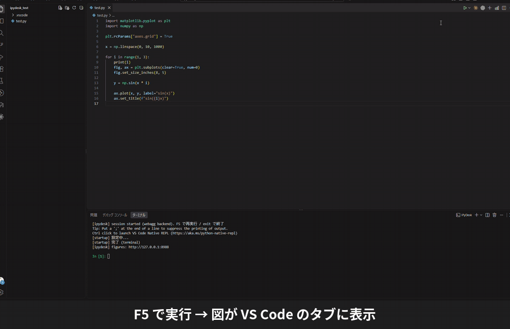

# IPyDesk — MATLAB-style Python desktop for VS Code

[](https://marketplace.visualstudio.com/items?itemName=bisan.ipydesk)
[](https://marketplace.visualstudio.com/items?itemName=bisan.ipydesk)

**Press F5 to run a Python script — its variables and figures stay after it finishes.**<br>
**F5 で Python スクリプトを実行。終わっても、変数と図がそのまま残ります。**



## Overview

IPyDesk runs your script inside a persistent IPython session, so you can work the MATLAB way:
run, look at the variables, then re-run only the part you are working on.

- **Variables stay after the run** — keep computing at the prompt when the script ends
- **Breakpoints and stepping** — click the gutter and press F5 (no debugpy, no `launch.json`)
- **Cell execution** with `# %%` — run the heavy setup once, repeat only the cell you are trying
- **Debug after an error** — jump to the failing line without re-running the script
- **Figures in VS Code tabs** — `plt.show()` never blocks; copy a figure as an image with Ctrl+C
- **Workspace view and Variable Editor** — open arrays and DataFrames as a table, and plot the selected range with one click

Requirements: **Windows only**, Python 3.9 or later. The rest of this page is written in Japanese.

## 概要

IPyDesk は、スクリプトを**常駐 IPython セッション**の中で実行します。
MATLAB のように「実行 → 変数を確認 → 一部だけ実行し直す」を繰り返せます。

- **実行が終わっても変数が残る** — そのままプロンプトで続きの計算ができます
- **赤丸（ブレークポイント）で停止・ステップ実行** — 行番号の左をクリックして F5 を押すだけ（debugpy も `launch.json` も不要）
- **`# %%` のセル実行** — 重い前処理は 1 回だけにして、試したいセルだけを何度でも
- **エラー後デバッグ** — 落ちた行で止まった状態に、走り直さずに入れます
- **図は VS Code のタブに表示** — `plt.show()` で止まらず、Ctrl+C で画像としてコピーできます
- **Workspace ビューと Variable Editor** — 配列・DataFrame を表で開き、選んだ範囲をボタン 1 つでプロット

## はじめかた

**必要なもの**

- **Windows**（macOS / Linux では動きません）
- **Python 3.9 以上**
- `ipython` `ipdb` `matplotlib` `tornado` — 足りなければ、初回の F5 で［インストール］を選ぶだけで入ります

**手順**

1. **フォルダを開きます**（ファイル → フォルダーを開く）。ファイル単体で開くと赤丸が効きません
2. `.py` ファイルを開き、行番号の左をクリックして赤丸を置きます
3. **F5** を押します。ターミナル「IPyDesk」が開き、赤丸の行で止まります
4. もう一度 F5 で続行します。最後まで進むと `In [n]:` に戻り、**変数がそのまま残っています**

「**IPyDesk: Open Desk**」（Workspace ビュー右上の ⊞）を実行すると、MATLAB のデスクトップのように並びます。

```
┌──────────┬──────────────┬──────────────┐
│Workspace │ コード        │ Figure /      │
│          │              │ Variable Editor│
│          ├──────────────┴──────────────┤
│          │ IPyDesk コンソール              │
└──────────┴─────────────────────────────┘
```

## キー操作

| キー | 動作 |
|---|---|
| **F5** | 実行（停止中は続行） |
| **Ctrl+F5** | 赤丸を無視して実行 |
| **Alt+F5** | 実行し、エラーが出たらその行で止まる |
| **Ctrl+Enter** / **Shift+Enter** | セルを実行 / 実行して次のセルへ |
| **Ctrl+Shift+Enter** | 選択範囲（選択が無ければ現在行）を実行 |
| **F10** / **F11** / **Shift+F11** | 停止中: ステップオーバー / ステップイン / ステップアウト |
| **Shift+F5** | 停止中: デバッガを抜けてプロンプトへ |
| **Ctrl+Shift+F5** | 空のセッションを新しく作る |

すべてのキーとコマンドは [実行とデバッグ](docs/run.md#キー操作の一覧) にあります。

## 詳しい使い方

| ガイド | 内容 |
|---|---|
| [実行とデバッグ](docs/run.md) | セッション、赤丸、セル実行、エラー後デバッグ、キー操作の一覧 |
| [スクリプトに引数を渡す](docs/arguments.md) | `argparse` / `sys.argv` への引数、履歴、Git での共有 |
| [図の表示](docs/figures.md) | Figure タブ、コピーと保存、描き直した図の履歴 |
| [変数を見る](docs/variables.md) | Workspace ビュー、Variable Editor（表・プロット・多次元配列）、Open Desk |
| [メモ（Notes ビュー）](docs/notes.md) | どのフォルダでも使えるメモ、コードの切り抜き |
| [.bat / .exe などを実行する](docs/run-file.md) | エクスプローラーから F5 でファイルを実行 |
| [設定](docs/settings.md) | 設定の一覧、`.vscode` に作られるファイル |

## うまく動かないとき

| 症状 | 対処 |
|---|---|
| 赤丸で止まらない | **フォルダを開いて**、その中にスクリプトを置く |
| 依存パッケージの確認が毎回出る | VS Code 右下で、パッケージを入れた環境（uv・venv の `.venv` など）を選ぶ（[詳しく](docs/settings.md#python-環境の選び方)） |
| 図が出ない / タブが空白 | `ipydesk.webaggPort` を別の番号に変えて Ctrl+Shift+F5 |
| Ctrl+Enter でインタラクティブウィンドウが開く | 「IPyDesk: Use IPyDesk Cell Keys」を実行する |
| 赤丸があると実行が遅い | Ctrl+F5 で赤丸を無視して実行する（[詳しく](docs/run.md#赤丸があると遅いとき)） |
| 動きがおかしい | Ctrl+Shift+F5 で新しいセッションを作り、おかしくなったセッションのターミナルを閉じる |

**制約**

- 停止中のマウスホバーでの変数表示には未対応です（Workspace ビューか `ipdb>` で確認します）
- 標準ライブラリ・IPython・matplotlib の内部には F11 でも入りません

## リンク

- [変更履歴](CHANGELOG.md)
- [不具合の報告・要望](https://github.com/tobisan22/ipydesk/issues)
- ライセンス: [MIT](LICENSE)
