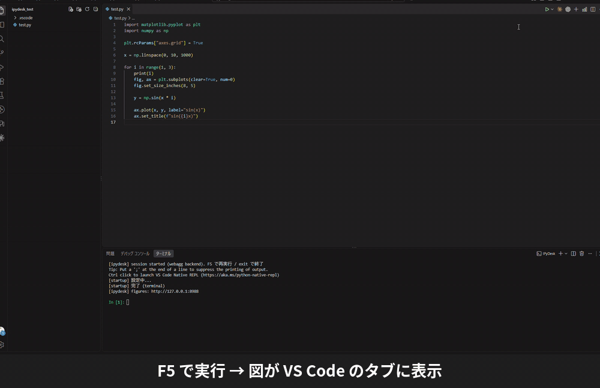

# 図の表示

[← README に戻る](../README.md)

matplotlib の figure ごとに、VS Code のタブが開きます。`plt.show()` で実行が止まることはありません。

## コピーと保存

- **📋** または **Ctrl+C** で、図を画像としてコピーします
- **💾** で png / svg / pdf に保存します

## 描き直した図の履歴

**同じ figure を描き直すと、前の図がタブの上側に残ります。**
F5 のたびに `plt.figure(1); plt.clf()` して描くスクリプトでも、上へスクロールすれば前回・前々回の図と見比べられます（いちばん下が今の図）。

- ループの中で `plt.subplots(num=0, clear=True)` / `plt.clf()` / `plt.close()` して同じ番号に描き直した場合も、
  消される直前の図が「途中 1」「途中 2」… として残ります（1 回の実行で figure ごとに上限枚数まで）
- 履歴の図は 📋 で画像としてコピーでき、「履歴を消す」でタブから消せます
- 残す枚数は `ipydesk.figureHistory`（既定 20、0 で無効）で変えられます
- `plt.figure()` のように毎回新しい番号で作る場合は、別のタブになります

## どのタブが前に出るか

実行のあとに前へ出るのは、**その実行で描いた figure のタブだけ**です。
何枚も描いたときは、最後に描いた figure が前に来ます。図を描かない実行では、今見ているタブをそのままにします。

## 表示先を変える

`ipydesk.figureDisplay` で切り替えられます。

| 値 | 表示のしかた |
|---|---|
| `tab`（既定） | VS Code のタブに出す。figure ごとに 1 タブで、作られたら自動で開く |
| `manual` | VS Code のタブに出すが、自動では開かない（「IPyDesk: Open Figures」で開く） |
| `window` | OS の別ウィンドウに出す（Qt / Tk）。タブ・📋 コピー・保存ダイアログは使えない |
| `none` | 図を表示しない。`plt.show()` は何もせず、`savefig` は使える |

変更したら、通知の「置き換える」を押すか、Ctrl+Shift+F5 で新しいセッションを作ってください。

図が出ない・タブが空白のときは、`ipydesk.webaggPort` を別の番号に変えて Ctrl+Shift+F5 を試してください。
